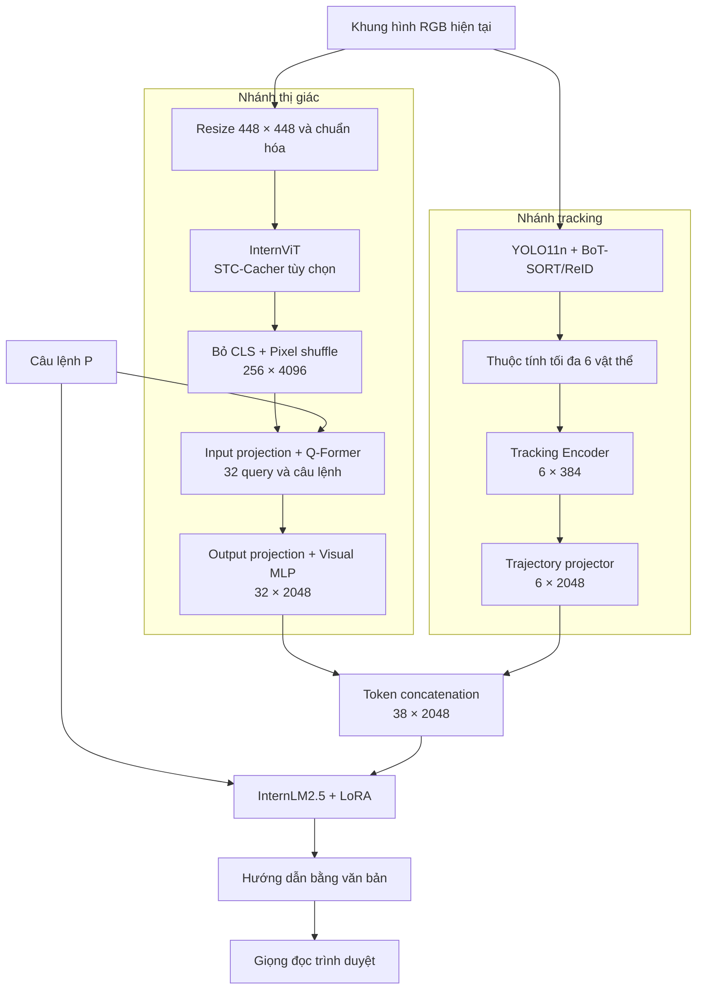
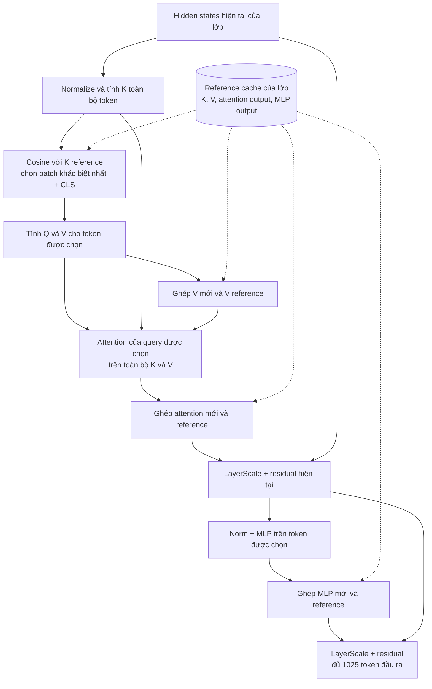
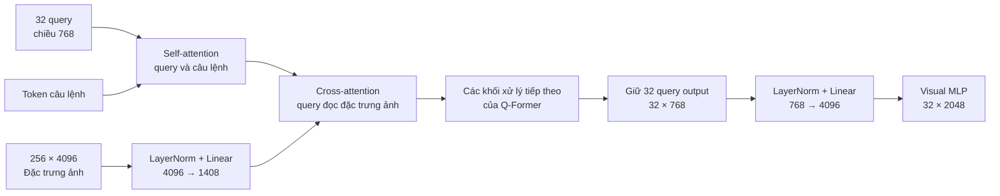

# Báo cáo kiến trúc hệ thống NavSVLM

**Nhánh thị giác, nhánh tracking, STC_Cacher, Q-Former, LLM và Fusion**

## Tóm tắt

NavSVLM giải quyết bài toán sinh hướng dẫn mô tả môi trường cho người khiếm thị từ chuỗi ảnh. Hệ thống kết hợp ngữ cảnh thị giác của khung hình hiện tại với thông tin vị trí và chuyển động của các vật thể được theo dõi, sau đó chuyển biểu diễn kết hợp sang mô hình ngôn ngữ để sinh hướng dẫn. Báo cáo trình bày sáu thành phần chức năng: nhánh thị giác, nhánh tracking, STC_Cacher, Q-Former, LLM và Fusion. Trong đó, STC_Cacher được tích hợp trong bộ mã hóa thị giác để tái sử dụng tính toán theo thời gian; Q-Former tổng hợp đặc trưng ảnh thành một tập token gọn có điều kiện theo câu lệnh. Hai thành phần này thuộc nhánh thị giác và được trình bày riêng để làm rõ cơ chế hoạt động.

Đầu vào của hệ thống là chuỗi khung hình RGB cùng câu lệnh mô tả cảnh; đầu ra là hướng dẫn bằng ngôn ngữ tự nhiên dựa trên quan sát mới nhất và trạng thái tracking. Phạm vi triển khai hiện tại tập trung vào mô tả môi trường và thông tin cần chú ý, chưa bao gồm định vị trên bản đồ hoặc lập kế hoạch đường đi toàn cục. Các kích thước tensor trong báo cáo được trình bày theo số token × chiều đặc trưng, lược bỏ chiều batch nếu không có chú thích khác.

Điểm phát triển của đề tài nằm ở cách đưa hai cơ chế này vào kiến trúc InternVL kết hợp thông tin theo dõi vật thể để sinh hướng dẫn. Q-Former được kết nối với đặc trưng InternViT bằng các lớp chiếu đầu vào và đầu ra; STC_Cacher được điều chỉnh để hoạt động trong các lớp InternViT và duy trì trạng thái qua chuỗi khung hình. Đây là **đóng góp về thiết kế, điều chỉnh và tích hợp phương pháp trong bài toán của đề tài**. Cơ chế Q-Former có điều kiện theo câu lệnh kế thừa [InstructBLIP](https://arxiv.org/abs/2305.06500), còn cơ chế tái sử dụng đặc trưng kế thừa [STC](https://arxiv.org/abs/2512.00891); mức độ mới so với các công trình khác cần được xác lập bằng khảo sát và thực nghiệm đối chứng.

## 1. Kiến trúc tổng thể

### 1.1. Ý tưởng phương pháp

Kiến trúc được tổ chức quanh hai nguồn thông tin bổ sung cho nhau. Nhánh thị giác cung cấp biểu diễn về nội dung và bố cục cảnh; nhánh tracking cung cấp thuộc tính có cấu trúc của các vật thể cùng trạng thái chuyển động qua thời gian. Fusion đưa hai nguồn thông tin về một chuỗi embedding chung để LLM tiếp nhận và sinh văn bản. Trong nhánh thị giác, Q-Former giới hạn số token đưa sang LLM, còn STC_Cacher giảm phần tính mới trong encoder ở các khung hình cập nhật chọn lọc.

| Thành phần | Vai trò | Đầu vào chính | Đầu ra hoặc tác động |
|---|---|---|---|
| Nhánh thị giác | Mã hóa cảnh và tạo biểu diễn ảnh cho LLM | Khung hình RGB và câu lệnh | 32 token thị giác, mỗi token 2048 chiều, sau Q-Former và các lớp chiếu |
| Nhánh tracking | Phát hiện, theo dõi và mã hóa thuộc tính vật thể | Khung hình RGB và trạng thái tracker | 6 slot token vật thể, mỗi token 2048 chiều |
| STC_Cacher | Tái sử dụng tính toán giữa các khung hình | Hidden states hiện tại và cache tham chiếu của từng lớp InternViT | Giảm phần tính mới, giữ nguyên kích thước chuỗi đầu ra |
| Q-Former | Tổng hợp đặc trưng ảnh có điều kiện theo câu lệnh | 256 token ảnh, 32 query và câu lệnh | 32 query output chiều 768, sau đó được chiếu sang không gian LLM |
| LLM | Diễn giải thông tin kết hợp và sinh hướng dẫn | Chuỗi embedding đa phương thức cùng văn bản câu lệnh | Hướng dẫn bằng ngôn ngữ tự nhiên |
| Fusion | Kết hợp biểu diễn của hai nhánh | 32 token thị giác và 6 token vật thể cùng chiều 2048 | Chuỗi 38 token thay thế embedding tại các vị trí ảnh trong prompt |

Sáu thành phần trên mô tả các mức chức năng khác nhau của hệ thống: hai nhánh tạo biểu diễn, hai mô-đun xử lý bên trong nhánh thị giác, cơ chế dung hợp và mô hình sinh ngôn ngữ. Thứ tự xử lý ở giai đoạn sinh hướng dẫn là tạo token từ hai nhánh, thực hiện Fusion, rồi chuyển kết quả sang LLM.

### 1.2. Luồng dữ liệu và kiến trúc kết hợp

NavSVLM là hệ thống thị giác–ngôn ngữ được xây dựng nhằm sinh hướng dẫn mô tả môi trường cho người khiếm thị từ chuỗi khung hình. Kiến trúc kết hợp biểu diễn thị giác của khung hình hiện tại với thông tin vị trí và chuyển động của các vật thể được theo dõi. Nhánh thị giác sử dụng InternViT và Q-Former để tạo biểu diễn ảnh có điều kiện theo câu lệnh; nhánh tracking sử dụng YOLO11n, BoT-SORT và Tracking Encoder để tạo biểu diễn vật thể. Đặc trưng của hai nhánh được chiếu về cùng không gian, nối thành chuỗi token và đưa vào mô hình ngôn ngữ để sinh hướng dẫn. STC-Cacher được tích hợp tùy chọn trong InternViT nhằm giảm tính toán lặp lại giữa các khung hình.

Cho chuỗi ảnh RGB đến thời điểm hiện tại là $I_{1:t}$ và câu lệnh hướng dẫn là $P$, quá trình suy luận được biểu diễn như sau:

$$
F_t=\mathcal{E}_{\mathrm{vis}}(I_t;\mathcal{C}_{t-1}),\qquad
O_t=\mathcal{T}(I_t;\mathcal{S}_{t-1}),
\tag{1}
$$

$$
Z_t^v=\mathcal{Q}(F_t,P),\qquad
Z_t^o=\mathcal{E}_{\mathrm{obj}}(O_t),\qquad
Y_t=\mathcal{G}\bigl(P,[Z_t^v;Z_t^o]\bigr).
\tag{2}
$$

Trong đó, $\mathcal{E}_{\mathrm{vis}}$ gồm InternViT và pixel shuffle; $\mathcal{T}$ là bộ phát hiện–theo dõi vật thể; $\mathcal{Q}$ gồm Q-Former và các lớp chiếu thị giác; $\mathcal{E}_{\mathrm{obj}}$ là Tracking Encoder kèm projector; $\mathcal{G}$ là mô hình sinh ngôn ngữ. $\mathcal{C}_{t-1}$ và $\mathcal{S}_{t-1}$ lần lượt là trạng thái cache STC và tracker trước khi xử lý frame $t$. Phép nối $[\cdot;\cdot]$ được thực hiện theo chiều chuỗi token. Khi tắt STC, nhánh thị giác tính đầy đủ và không sử dụng $\mathcal{C}_{t-1}$.



*Hình 1. Kiến trúc tổng thể NavSVLM. Kích thước biểu diễn được ghi theo số token × chiều đặc trưng, lược bỏ chiều batch. Hai nhánh thể hiện phụ thuộc dữ liệu; triển khai hiện tại thực thi các bước tuần tự.*

Mô hình nền được sử dụng là `OpenGVLab/InternVL2_5-2B`. Q-Former được nạp từ `Salesforce/instructblip-flan-t5-xl`, còn mô hình ngôn ngữ đầu ra là InternLM2.5 trong InternVL. Hệ thống duy trì tracking và mã hóa thị giác ở mỗi frame, nhưng chỉ thực hiện Q-Former, Tracking Encoder và sinh ngôn ngữ khi có yêu cầu hướng dẫn. Do đó, chu kỳ cập nhật quan sát và chu kỳ sinh văn bản có thể được thiết lập riêng.

## 2. Nhánh thị giác

### 2.1. Vai trò và thành phần

Nhánh thị giác chuyển khung hình RGB thành biểu diễn số để mô hình ngôn ngữ có thể khai thác nội dung cảnh. Luồng xử lý gồm tiền xử lý ảnh, InternViT, pixel shuffle, Q-Former và các lớp chiếu sang không gian embedding của LLM. STC_Cacher được tích hợp tùy chọn trong InternViT. Nhánh này cung cấp ngữ cảnh ảnh, trong khi thông tin vật thể có cấu trúc được bổ sung từ nhánh tracking.

### 2.2. Tiền xử lý và mã hóa ảnh

InternViT đảm nhiệm chức năng chuyển ảnh thành đặc trưng thị giác. Ảnh được resize và chuẩn hóa về $448\times448$, chia thành 1024 patch kích thước $14\times14$. Với một token CLS bổ sung, encoder xử lý chuỗi 1025 token, chiều đặc trưng 1024, qua 24 lớp Transformer. Đây là vị trí tích hợp STC_Cacher để tái sử dụng tính toán giữa các frame.

Đầu ra CLS được loại bỏ trước pixel shuffle. Với tỷ lệ downsample 0,5, lưới đặc trưng được sắp xếp lại từ $32\times32\times1024$ thành $16\times16\times4096$, tạo tensor $F_t\in\mathbb{R}^{256\times4096}$. Pixel shuffle giảm số vị trí không gian bằng cách chuyển thông tin sang chiều kênh; bước tổng hợp biểu diễn theo câu lệnh được thực hiện tiếp theo bởi Q-Former. Đường suy luận hiện tại sử dụng một ảnh đơn cho mỗi frame, chưa áp dụng chia ảnh thành nhiều tile.

### 2.3. Giao diện đầu ra

Sau pixel shuffle, 256 token ảnh được chuyển sang Q-Former cùng câu lệnh. Q-Former giữ lại 32 query output, sau đó các lớp chiếu và visual MLP tạo biểu diễn $Z_t^v\in\mathbb{R}^{32\times2048}$. Đây là đầu ra cuối của nhánh thị giác đưa vào Fusion. Việc tách đầu ra encoder $F_t$ khỏi đầu ra toàn nhánh $Z_t^v$ giúp phân biệt giai đoạn cập nhật quan sát ở mỗi frame với giai đoạn tổng hợp theo câu lệnh khi sinh hướng dẫn.

## 3. Nhánh tracking

### 3.1. Vai trò và quá trình theo dõi

Nhánh tracking cung cấp thông tin có cấu trúc về các vật thể xuất hiện trong chuỗi ảnh. Dữ liệu này bổ sung cho biểu diễn cảnh của nhánh thị giác, đặc biệt ở các thuộc tính như nhãn vật thể, vị trí tương đối và trạng thái chuyển động. Luồng xử lý gồm phát hiện vật thể, liên kết đối tượng qua thời gian, lựa chọn đối tượng và mã hóa thuộc tính thành token.

YOLO11n cung cấp nhãn và bounding box; BoT-SORT với ReID duy trì ID cùng trạng thái chuyển động qua các frame. Nhánh này tạo dữ liệu có cấu trúc về vật thể để bổ sung cho ngữ cảnh ảnh. Hệ thống lấy tối đa sáu đối tượng theo tọa độ cạnh dưới bounding box giảm dần, rồi biểu diễn mỗi đối tượng bằng nhãn, hướng tương đối, bbox chuẩn hóa và thuộc tính chuyển động. Quy tắc chọn đối tượng là heuristic theo vị trí ảnh; tốc độ cũng được tính trên ảnh, chưa phải khoảng cách hay vận tốc vật lý.

### 3.2. Biểu diễn thuộc tính vật thể

Mỗi vật thể được biểu diễn bằng một mã nhãn, một mã hướng tương đối và sáu đặc trưng số. Mã nhãn được ánh xạ từ tên lớp do detector trả về sang bộ từ vựng của Tracking Encoder. Hướng tương đối được xác định từ vị trí ngang của tâm bounding box so với tâm ảnh và ánh xạ sang các hướng theo mặt đồng hồ. Sáu đặc trưng số gồm bốn tọa độ bounding box chuẩn hóa, góc chuyển động chuẩn hóa và độ lớn chuyển động được chuẩn hóa theo đường chéo ảnh.

Track ID được sử dụng để truy xuất trạng thái chuyển động của đúng vật thể trong tracker. ID không được đưa trực tiếp vào Tracking Encoder dưới dạng một embedding riêng. Khi có ít hơn sáu đối tượng hợp lệ, hệ thống bổ sung các slot đệm và sử dụng `object_mask` để phân biệt slot thật với slot đệm.

### 3.3. Tracking Encoder và phép chiếu đầu ra

Tracking Encoder chuyển thuộc tính vật thể thành token để LLM có thể tiếp nhận. Embedding nhãn, hướng và đặc trưng số được kết hợp, sau đó xử lý bằng Transformer Encoder để mô hình hóa quan hệ giữa các slot vật thể hiện tại. Sáu token đầu ra chiều 384 được chiếu sang chiều 2048; object mask xử lý vị trí đệm và đưa token không hợp lệ về vector 0. Thông tin thời gian chủ yếu đến từ tracker, còn slot trong danh sách không cố định theo track ID.

Trong quá trình mã hóa, nhãn và hướng được chuyển thành embedding, còn đặc trưng số đi qua một MLP. Các biểu diễn này được nối theo chiều đặc trưng và đưa qua MLP vật thể. Sau khi bổ sung embedding vị trí slot, Transformer Encoder xử lý quan hệ giữa các vật thể hợp lệ. Đầu ra cuối của nhánh là $Z_t^o\in\mathbb{R}^{6\times2048}$, tương thích với chiều embedding của nhánh thị giác tại đầu vào Fusion.

### 3.4. Giới hạn của biểu diễn tracking

Thứ tự slot được xác định lại theo vị trí bounding box ở mỗi lần cập nhật, nên cùng một slot có thể chứa các track ID khác nhau ở những frame khác nhau. Tracking Encoder hiện xử lý tập thuộc tính tại thời điểm đang xét; mô-đun này không trực tiếp nhận toàn bộ lịch sử quỹ đạo dưới dạng một chuỗi thời gian. Ngoài ra, quy tắc ưu tiên theo cạnh dưới bounding box không xác lập khoảng cách thực đến vật thể. Chất lượng đầu ra của nhánh phụ thuộc vào kết quả phát hiện, liên kết ID và ước lượng chuyển động của tracker.

## 4. STC-Cacher: tái sử dụng tính toán thị giác theo thời gian

### 4.1. Động cơ và thiết kế tổng quát

Trong dữ liệu video, nhiều vùng ảnh duy trì đặc trưng tương tự qua các frame gần nhau. Tính lại toàn bộ Vision Encoder ở mỗi frame có thể tạo lượng công việc lặp đáng kể. NavSVLM tích hợp STC-Cacher để khai thác tính dư thừa này bằng cách duy trì một frame tham chiếu và chỉ tính lại các token được xem là thay đổi nhiều ở những frame kế tiếp.

Trong bài toán của đề tài, hệ thống tiếp nhận quan sát liên tục trong khi hướng dẫn được sinh theo yêu cầu hoặc theo chu kỳ. Do đó, chi phí mã hóa ảnh vẫn phát sinh ở các frame chưa sinh văn bản. STC_Cacher tác động trực tiếp vào giai đoạn cập nhật quan sát này: mỗi frame vẫn được tiếp nhận, nhưng lượng tính toán mới trong encoder được điều chỉnh theo mức thay đổi của đặc trưng. Cơ chế này phù hợp với mục tiêu giảm độ trễ xử lý chuỗi, còn mức cải thiện thực tế phụ thuộc dữ liệu và cấu hình chạy.

Adapter được điều chỉnh từ thuật toán selective-key trong mã nguồn STC đi kèm project. Hai chế độ được sử dụng: **reference**, tính đầy đủ và cập nhật cache; **selective**, tính chọn lọc dựa trên cache tham chiếu. Cơ chế hoạt động bên trong từng lớp InternViT và giữ nguyên số token đầu ra. Vì vậy, pixel shuffle và Q-Former tiếp tục nhận tensor có cùng kích thước như khi chạy encoder gốc.

Gọi $\Delta$ là chu kỳ làm mới. Với frame được đánh số từ 1, reference frame thỏa mãn $(t-1)\bmod\Delta=0$. Khi $\Delta=4$, các frame 1, 5 và 9 là reference; các frame 2–4 và 6–8 sử dụng tính toán selective. Reference cache được giữ cố định trong khoảng này, thay vì cập nhật cuốn chiếu sau từng selective frame.

### 4.2. Bộ nhớ tham chiếu theo lớp

Với lớp $\ell$, đầu vào được ký hiệu $X_t^\ell\in\mathbb{R}^{N\times d}$, trong đó $N=1025$ và $d=1024$ ở cấu hình hiện tại. Tại reference frame $r$, forward gốc của lớp được giữ nguyên và bốn tensor trung gian được lưu:

$$
\mathcal{C}_r^\ell=
\left\{K_r^\ell,V_r^\ell,A_r^\ell,M_r^\ell\right\}.
\tag{3}
$$

$K_r^\ell$ và $V_r^\ell$ lần lượt là key và value. $A_r^\ell$ là đầu ra khối attention sau output projection, trước LayerScale và residual; $M_r^\ell$ là đầu ra MLP trước LayerScale và residual. Như vậy, cache attention chứa đặc trưng kích thước $N\times d$, không lưu ma trận attention weight kích thước $N\times N$.

Key tham chiếu được lưu sau K normalization nếu cấu hình mô hình có bật tùy chọn này. Adapter hỗ trợ fused QKV, Q/K normalization và LayerScale của InternViT; cấu hình base đang sử dụng có `qk_normalization=false`. Các tensor cache là trạng thái suy luận, không bổ sung trọng số học mới và không được lưu vào `state_dict`.

### 4.3. Lựa chọn token dựa trên khác biệt của key

Tại selective frame, hệ thống vẫn tính key cho toàn bộ token của lớp:

$$
U_t^\ell=\operatorname{LN}_1(X_t^\ell),\qquad
K_t^\ell=\operatorname{Proj}_K(U_t^\ell).
\tag{4}
$$

$\operatorname{Proj}_K$ bao gồm bias và K normalization nếu có. Mức tương đồng giữa mỗi patch hiện tại và patch cùng vị trí của reference được tính bằng cosine:

$$
s_{t,i}^\ell=
\frac{\langle K_{t,i}^\ell,K_{r,i}^\ell\rangle}
{\|K_{t,i}^\ell\|_2\,\|K_{r,i}^\ell\|_2}.
\tag{5}
$$

Công thức biểu diễn cosine ở dạng chuẩn; triển khai sử dụng `cosine_similarity` với cơ chế bảo vệ mẫu số khi chuẩn vector nhỏ. Điểm thấp biểu thị khác biệt đặc trưng lớn hơn. Gọi $\rho\in(0,1]$ là tỷ lệ patch được cập nhật và $N_p=N-1$ là số patch không tính CLS. Tập token được chọn là:

$$
k_p=\max\{1,\lfloor\rho N_p\rfloor\},\qquad
\mathcal{I}_t^\ell=\{\mathrm{CLS}\}\cup
\operatorname{BottomK}\!\left(\{s_{t,i}^\ell\}_{i=1}^{N_p},k_p\right).
\tag{6}
$$

$\operatorname{BottomK}$ trả về chỉ số của $k_p$ patch có cosine nhỏ nhất. Với $\rho=0.25$, mỗi selective layer cập nhật 256 patch và một CLS, tương ứng 257 token. Việc chọn được thực hiện riêng ở mỗi lớp, nên tập chỉ số có thể thay đổi theo độ sâu của encoder. Khi $\rho=1$, tất cả token được chọn và bước xếp hạng được bỏ qua.

Tiêu chí trên phản ánh thay đổi trong không gian key, không trực tiếp biểu diễn mức quan trọng ngữ nghĩa hay nguy cơ va chạm. Do đó, nó không bảo đảm mọi vật thể liên quan đến điều hướng đều được chọn để tính mới ở mỗi lớp.

### 4.4. Tính toán attention có chọn lọc

Sau khi xác định tập $\mathcal{I}=\mathcal{I}_t^\ell$, query và value mới chỉ được tính cho các token thuộc tập này. Value dùng trong attention được xây dựng bằng cách ghép giá trị mới với giá trị tham chiếu:

$$
Q_{t,\mathcal{I}}^\ell=\operatorname{Proj}_Q(U_{t,\mathcal{I}}^\ell),\qquad
\widehat V_{t,i}^\ell=
\begin{cases}
\operatorname{Proj}_V(U_{t,i}^\ell),&i\in\mathcal{I},\\
V_{r,i}^\ell,&i\notin\mathcal{I}.
\end{cases}
\tag{7}
$$

$\operatorname{Proj}_Q$ bao gồm Q normalization nếu có. Các query được chọn tiếp tục attention tới **toàn bộ key hiện tại** và value đã ghép. Với $\operatorname{MHA}$ bao gồm multi-head attention và output projection:

$$
A_{t,\mathcal{I}}^{\ell,\mathrm{new}}=
\operatorname{MHA}(Q_{t,\mathcal{I}}^\ell,K_t^\ell,\widehat V_t^\ell),\qquad
\widehat A_{t,i}^\ell=
\begin{cases}
A_{t,i}^{\ell,\mathrm{new}},&i\in\mathcal{I},\\
A_{r,i}^\ell,&i\notin\mathcal{I}.
\end{cases}
\tag{8}
$$

Như vậy, phạm vi query được rút gọn nhưng miền key/value vẫn bao phủ toàn bộ ảnh. Phần attention không được tính mới được lấy từ reference của cùng lớp. Triển khai ghép trên bản sao tensor tham chiếu, tránh làm thay đổi cache đang được sử dụng cho các frame tiếp theo.

### 4.5. Cập nhật MLP và bảo toàn residual

Đầu ra attention đã ghép được đưa qua LayerScale rồi cộng vào hidden states hiện tại. Sau bước này, MLP chỉ được tính trên các token đã chọn:

$$
R_t^\ell=X_t^\ell+\gamma_1^\ell\odot\widehat A_t^\ell,\qquad
\widehat M_{t,i}^\ell=
\begin{cases}
\operatorname{MLP}^{\ell}(\operatorname{LN}_2(R_{t,i}^\ell)),&i\in\mathcal{I},\\
M_{r,i}^\ell,&i\notin\mathcal{I},
\end{cases}
\tag{9}
$$

$$
X_t^{\ell+1}=R_t^\ell+\gamma_2^\ell\odot\widehat M_t^\ell.
\tag{10}
$$

$\gamma_1^\ell$ và $\gamma_2^\ell$ là hệ số LayerScale, còn $\odot$ là phép nhân theo phần tử. Các công thức mô tả chế độ suy luận, khi DropPath không loại bỏ nhánh residual. Một điểm quan trọng là residual luôn xuất phát từ hidden states hiện tại. Vì vậy, token không được chọn tái sử dụng đầu ra các nhánh attention/MLP, nhưng không sao chép nguyên hidden state cuối của reference.



*Hình 2. Đường tính selective của STC-Cacher tại một lớp InternViT. Reference cache chỉ được làm mới ở reference frame hoặc khi cần khởi tạo lại trạng thái.*

### 4.6. Chi phí tính toán và bộ nhớ

Gọi $k=k_p+1$ là số token được cập nhật, bao gồm CLS. Trong selective attention, phần nhân ma trận tương tác query–key có quy mô theo $kN$ thay cho $N^2$; MLP xử lý $k$ token thay cho $N$. Tuy nhiên, key projection vẫn chạy trên toàn bộ token, đồng thời phát sinh chi phí cosine, chọn chỉ số, sao chép và ghép tensor. Vì vậy, tỷ lệ cập nhật $\rho$ không thể được chuyển trực tiếp thành tỷ lệ tăng tốc.

Với chuỗi chín frame, $\Delta=4$, $\rho=0.25$ và 24 lớp encoder, tổng số lượt token đi qua MLP là 221.400 ở baseline và 110.808 khi bật STC, giảm khoảng 49,95%. Đây là số lượt token qua MLP, không phải mức giảm FLOPs toàn mô hình. Reference frame vẫn thực hiện forward đầy đủ và phải lưu các tensor cache.

Với batch một ảnh và bốn tensor $N\times d$ trên mỗi lớp, dung lượng reference cache FP32 được xác định bởi $4\times24\times1025\times1024\times4$ byte, tương ứng **384,375 MiB**. Con số này chưa bao gồm trọng số mô hình, tensor tạm, tracker và KV cache của LLM. Giảm tỷ lệ cập nhật không làm giảm tương ứng dung lượng reference, vì cache vẫn lưu đủ các vị trí token.

### 4.7. Điều kiện vận hành và đánh đổi

STC-Cacher chỉ được áp dụng khi suy luận; khi mô hình ở chế độ training hoặc gradient đang bật, adapter xóa cache và sử dụng forward gốc. Thay đổi shape, device hoặc dtype đầu vào làm cache được khởi tạo lại. Runtime cũng reset tracker và STC khi đổi stream, đổi kích thước nguồn hoặc phát lại một chuỗi; seek, cắt cảnh hay đổi layout crop cần được thông báo bằng thao tác reset. Chưa có cơ chế tự động phát hiện cắt cảnh.

Hai tham số chính là tỷ lệ cập nhật $\rho$ và chu kỳ reference $\Delta$. Cập nhật ít token hoặc làm mới reference thưa hơn làm tăng mức tái sử dụng, đồng thời có thể tăng sai lệch đặc trưng khi chuyển động hoặc nội dung cảnh thay đổi. Cấu hình được dùng trong benchmark là $\rho=0.25$, $\Delta=4$; runtime mặc định tắt STC và cho phép bật qua biến môi trường `STC_PATCH_VISION=1`.

STC-Cacher và Q-Former tác động ở các vị trí khác nhau: STC giảm phần tính mới trong encoder nhưng giữ nguyên chuỗi đầu ra, còn Q-Former giảm số token ảnh chuyển sang LLM. Đường triển khai hiện tại sử dụng STC-Cacher, không tích hợp STC-Pruner của framework STC.

### 4.8. Phần điều chỉnh STC_Cacher cho kiến trúc của đề tài

Thuật toán selective-key được kế thừa từ mã nguồn STC. Phần phát triển trong NavSVLM là adapter `InternViTSTCCacher`, đưa cơ chế này vào cấu trúc và luồng suy luận của InternViT. Các điều chỉnh chính gồm:

| Yêu cầu tích hợp | Cách xử lý trong adapter | Ý nghĩa |
|---|---|---|
| InternViT gộp Q, K, V trong một lớp Linear | Tách các phần trọng số của fused QKV để tính K toàn bộ và Q/V cho token được chọn | Thực hiện tính chọn lọc với cấu trúc trọng số sẵn có |
| Bảo toàn phép biến đổi của từng lớp | Hỗ trợ Q/K normalization khi bật, LayerScale và residual từ hidden states hiện tại | Đặt cơ chế cache đúng vị trí trong khối Transformer |
| Kết nối với pixel shuffle và Q-Former | Ghép kết quả mới với reference tại đúng vị trí token | Giữ nguyên kích thước và thứ tự chuỗi đầu ra |
| Xử lý video có trạng thái | Quản lý reference theo lớp, làm mới định kỳ và cung cấp thao tác reset | Tránh dùng tiếp trạng thái của chuỗi cũ khi chuyển nguồn dữ liệu |
| Đối chiếu với encoder gốc | Giữ forward đầy đủ ở reference frame và cho phép gỡ adapter | Có đường baseline để kiểm tra sai lệch và hiệu năng |

Những điều chỉnh trên tạo khả năng vận hành STC_Cacher trong nhánh thị giác của NavSVLM mà không bổ sung trọng số học cho cơ chế cache. Thông tin được lưu ở mỗi lớp phục vụ tái sử dụng tính toán; việc nhận biết vật thể và sinh ngôn ngữ vẫn do các mô-đun tương ứng đảm nhiệm. Tiêu chí chọn token dựa trên key hiện chưa sử dụng bounding box, track ID hoặc câu lệnh, nên mức thay đổi đặc trưng cần được phân biệt với mức quan trọng của vật thể đối với người dùng.

Nội dung đóng góp có thể phát biểu như sau: **Đề tài điều chỉnh và tích hợp STC_Cacher vào InternViT để cập nhật chọn lọc đặc trưng theo thời gian, bảo toàn giao diện đầu ra cho Q-Former và quản lý reference cache trong quá trình xử lý chuỗi.** Mức giảm độ trễ và sai lệch đặc trưng được đánh giá bằng benchmark; chất lượng hướng dẫn tại các frame selective là phần cần kiểm chứng tiếp.

### 4.9. Minh họa vòng đời cache trên chuỗi khung hình

Với chu kỳ tham chiếu $\Delta=4$, tỷ lệ cập nhật $\rho=0.25$ và chuỗi chín frame được đánh số từ 1, lịch xử lý khi không có thao tác reset như sau:

| Frame | Chế độ | Frame cung cấp cache | Số token tính mới qua MLP ở mỗi lớp | Trạng thái cache sau khi xử lý |
|---|---|---|---:|---|
| 1 | Reference | Tạo từ frame 1 | 1025 | Lưu reference của frame 1 |
| 2, 3, 4 | Selective | Frame 1 | 257 mỗi frame | Giữ reference của frame 1 |
| 5 | Reference | Tạo từ frame 5 | 1025 | Thay reference bằng frame 5 |
| 6, 7, 8 | Selective | Frame 5 | 257 mỗi frame | Giữ reference của frame 5 |
| 9 | Reference | Tạo từ frame 9 | 1025 | Thay reference bằng frame 9 |

Ví dụ, khi xử lý frame 4, key hiện tại được so sánh với key của frame 1 tại cùng lớp và cùng vị trí patch. Frame 2 và frame 3 không trở thành reference mới. Tập token cần tính lại vẫn được xác định riêng cho frame 4 và riêng tại từng lớp. Kết quả ghép ở selective frame được tạo trên bản sao tensor tham chiếu, nên các giá trị vừa tính không ghi đè vào reference đang lưu.

Ở một selective layer với 1025 token đầu vào, phép tính key vẫn xử lý đủ 1025 vị trí. Query và value mới được tính cho 257 vị trí; attention của 257 query sử dụng 1025 key hiện tại cùng 1025 value đã ghép. MLP chỉ tính mới tại 257 vị trí, nhưng đầu ra của lớp vẫn có đủ 1025 token nhờ ghép kết quả nhánh và cộng residual hiện tại. Đây là cơ sở để pixel shuffle và Q-Former giữ nguyên giao diện đầu vào khi bật STC_Cacher.

Chu kỳ trên được tính theo số lần gọi encoder cho các frame đã tiếp nhận, không theo số lần sinh hướng dẫn. Nếu có thao tác reset do đổi stream hoặc bắt đầu lại chuỗi, frame tiếp theo khởi tạo một reference mới và lịch tham chiếu được tính lại từ đầu. Việc gọi sinh hướng dẫn trên đặc trưng đã lưu không tự làm mới STC cache. Cơ chế này được triển khai trong `InternViTSTCCacher._forward`, `_reference_forward`, `_layer_forward` và được phối hợp với runtime qua `StreamingPipeline.process_frame`.

## 5. Q-Former: trích xuất đặc trưng thị giác có điều kiện theo câu lệnh

### 5.1. Thiết kế và vai trò

Đối với bài toán hỗ trợ mô tả môi trường, câu lệnh xác định loại thông tin cần được tổng hợp từ ảnh. Vì vậy, NavSVLM đặt Q-Former sau bước mã hóa ảnh và trước visual MLP, để câu lệnh tác động vào quá trình tạo biểu diễn thị giác ngay trước khi đưa biểu diễn đó sang mô hình ngôn ngữ. Ví dụ, yêu cầu mô tả chướng ngại vật phía trước cung cấp ngữ cảnh nhiệm vụ cho các query khi đọc đặc trưng ảnh. Đây là cơ chế điều kiện hóa; khả năng tập trung đúng vùng nguy hiểm vẫn cần được đánh giá bằng thực nghiệm.

Q-Former đóng vai trò cầu nối giữa đặc trưng ảnh có độ dài lớn và không gian đầu vào của mô hình ngôn ngữ. Trong NavSVLM, thành phần này nhận 256 token sau pixel shuffle, 32 query token và câu lệnh mô tả cảnh. Đầu ra được giới hạn ở 32 vị trí query, tạo biểu diễn thị giác gọn trước khi chuyển sang LLM. Cơ chế đưa câu lệnh vào Q-Former kế thừa thiết kế instruction-aware của InstructBLIP, cho phép quá trình trích xuất thị giác được điều kiện hóa theo nhiệm vụ ngôn ngữ. [Nguồn: InstructBLIP](https://arxiv.org/abs/2305.06500).

Query token là các vector tham số được học trước, có vai trò truy vấn thông tin từ đặc trưng ảnh. Chúng không có ràng buộc tương ứng một-một với patch hoặc đối tượng. Một query có thể tổng hợp thông tin từ nhiều vùng ảnh, trong khi một vùng ảnh có thể đóng góp cho nhiều query. Trong quá trình suy luận hiện tại, trọng số query được giữ cố định; biểu diễn đầu ra của query thay đổi theo ảnh và câu lệnh.

### 5.2. Căn chỉnh không gian đặc trưng

Đặc trưng sau pixel shuffle của InternViT có chiều 4096, trong khi đầu vào thị giác của Q-Former sử dụng chiều 1408. Vì vậy, một lớp chuẩn hóa và phép chiếu tuyến tính được sử dụng để căn chỉnh hai không gian:

$$
\widetilde F_t=\operatorname{LN}(F_t)W_{\mathrm{in}}+b_{\mathrm{in}},
\qquad \widetilde F_t\in\mathbb{R}^{256\times1408},
\tag{11}
$$

với $W_{\mathrm{in}}\in\mathbb{R}^{4096\times1408}$. Tập query ban đầu được ký hiệu là $Q_0\in\mathbb{R}^{32\times768}$. Câu lệnh $P$ được tokenize bằng tokenizer của Q-Former, với độ dài văn bản tối đa 128 token. Các query và token câu lệnh tham gia quá trình xử lý của Q-Former, còn $\widetilde F_t$ cung cấp nguồn đặc trưng cho các lớp cross-attention.

### 5.3. Tương tác giữa query, câu lệnh và ảnh

Self-attention cho phép biểu diễn query tương tác với token câu lệnh. Tại các lớp có cross-attention, query tổng hợp thông tin từ đặc trưng ảnh. Để minh họa phép đọc ảnh của một attention head, gọi $H_q$ là biểu diễn query ở lớp đang xét:

$$
Q=H_qW_Q,\qquad K=\widetilde F_tW_K,\qquad V=\widetilde F_tW_V,
\tag{12}
$$

$$
\operatorname{Attn}(Q,K,V)
=\operatorname{softmax}\left(\frac{QK^\top}{\sqrt{d_h}}\right)V.
\tag{13}
$$

Trong đó $d_h$ là chiều của một head. Ma trận attention có 32 hàng query và 256 cột đặc trưng ảnh. Mỗi hàng xác định cách một query tổng hợp thông tin từ các vị trí ảnh. Các phép chiếu Q, K và V ánh xạ query và đặc trưng ảnh từ những chiều đầu vào khác nhau về không gian tương thích cho attention. Công thức (12)–(13) mô tả phép tính của một head, lược bỏ bias; Q-Former thực tế sử dụng nhiều head cùng các khối feed-forward, normalization và residual.

Trong triển khai, attention mask bao gồm 32 vị trí query hợp lệ và mask của câu lệnh; các vị trí ảnh được đánh dấu hợp lệ bằng encoder attention mask. Sau khi chạy Q-Former, chỉ 32 vị trí đầu trong `last_hidden_state` được giữ lại:

$$
H_t=\operatorname{QFormer}(Q_0,P,\widetilde F_t)_{1:32},
\qquad H_t\in\mathbb{R}^{32\times768}.
\tag{14}
$$

Token văn bản bên trong Q-Former hỗ trợ điều kiện hóa biểu diễn nhưng không được nối vào đầu ra thị giác. Câu lệnh được đưa riêng vào LLM ở giai đoạn sinh hướng dẫn. Với cấu hình hiện tại, câu lệnh tập trung vào chướng ngại vật trước mắt, hướng tương đối và hành động cần chú ý; đây là prompt cố định trong runtime.



*Hình 3. Cơ chế Q-Former trong NavSVLM. Sơ đồ khái quát tương tác query–text và query–image, lược bỏ các nhánh residual và chi tiết từng lớp. Cross-attention được thực hiện ở các lớp tương ứng của mô hình nguồn.*

### 5.4. Chiếu đầu ra và tích hợp với InternVL

Đầu ra Q-Former có chiều 768, chưa phù hợp với visual MLP sẵn có của InternVL. Hệ thống sử dụng thêm một lớp chiếu để đưa biểu diễn về chiều 4096, sau đó áp dụng visual MLP để nhận embedding chiều 2048:

$$
Z_t^v=\operatorname{MLP}_{\mathrm{vis}}\!\left(
\operatorname{LN}(H_t)W_{\mathrm{out}}+b_{\mathrm{out}}
\right),\qquad Z_t^v\in\mathbb{R}^{32\times2048},
\tag{15}
$$

với $W_{\mathrm{out}}\in\mathbb{R}^{768\times4096}$. Hai phép chiếu ở công thức (11) và (15) tạo cầu nối giữa InternViT, Q-Former và visual MLP. Trọng số của chúng được nạp từ checkpoint bridge; Q-Former và các query được nạp từ mô hình InstructBLIP nguồn. Hệ thống không sử dụng Flan-T5 để sinh đầu ra.

| Giai đoạn | Số token | Chiều đặc trưng |
|---|---:|---:|
| Đầu ra sau pixel shuffle | 256 | 4096 |
| Đầu vào thị giác của Q-Former | 256 | 1408 |
| Query output của Q-Former | 32 | 768 |
| Sau output projection | 32 | 4096 |
| Sau visual MLP | 32 | 2048 |

*Bảng 1. Kích thước biểu diễn qua Q-Former và các lớp kết nối, với một ảnh đầu vào.*

### 5.5. Ý nghĩa của phép nén

Q-Former giảm số token ảnh từ 256 xuống 32, tương ứng hệ số nén 8 lần ở giao diện thị giác đưa sang LLM. Khác với việc chọn một tập con patch, 32 token đầu ra là các biểu diễn tổng hợp qua attention. Thiết kế này giới hạn chiều dài chuỗi đa phương thức, đồng thời cho phép câu lệnh tham gia vào bước hình thành biểu diễn.

Hệ số nén không trực tiếp biểu thị mức tăng tốc của toàn hệ thống, vì Q-Former và các lớp chiếu cũng tiêu tốn tính toán. Việc tổng hợp về một số query cố định có thể làm mất chi tiết ảnh. Do chưa có thực nghiệm đối chứng loại bỏ Q-Former với đường chạy và trọng số tương thích, hiệu quả riêng của thành phần này đối với độ trễ và chất lượng hướng dẫn chưa được định lượng trong project.

### 5.6. Phần phát triển trong bài toán của đề tài

Đóng góp ở thành phần này là xây dựng cầu nối để sử dụng Q-Former có điều kiện theo câu lệnh trong nhánh thị giác của InternVL. Cụ thể, đặc trưng sau pixel shuffle của InternViT được chiếu từ 4096 về 1408 chiều để Q-Former tiếp nhận; 32 query output được chiếu từ 768 về 4096 chiều để đi qua visual MLP hiện có. Nhờ đó, hệ thống kết nối được các mô-đun có không gian đặc trưng khác nhau và tạo đầu ra thống nhất ở chiều 2048 của LLM.

Trong kiến trúc kết hợp, Q-Former tổng hợp ngữ cảnh thị giác theo câu lệnh, còn Tracking Encoder cung cấp sáu token thuộc tính vật thể. Hai nguồn thông tin được nối sau các phép chiếu riêng. Q-Former hiện chỉ nhận đặc trưng ảnh và câu lệnh; dữ liệu tracking không được đưa vào cross-attention của Q-Former. Sự kết hợp giữa thông tin ảnh và vật thể diễn ra ở đầu vào của LLM.

Vì vậy, nội dung đóng góp có thể phát biểu như sau: **Đề tài xây dựng nhánh biểu diễn thị giác có điều kiện theo yêu cầu hướng dẫn, kết nối Q-Former với InternViT và visual MLP thông qua các lớp chiếu, đồng thời phối hợp biểu diễn ảnh đã rút gọn với token vật thể để phục vụ sinh hướng dẫn.** Cơ chế query và instruction-aware attention được kế thừa từ mô hình nguồn; hiệu quả của cách tích hợp đối với bài toán cần được kiểm chứng riêng.

### 5.7. Quy trình suy luận và ý nghĩa của các loại token

Ba loại dữ liệu tham gia Q-Former có vai trò khác nhau. Token ảnh cung cấp nội dung thị giác; token câu lệnh cung cấp ngữ cảnh nhiệm vụ; query token xác định 32 vị trí biểu diễn cần tổng hợp. Query đầu vào là tham số được nạp từ checkpoint, còn query output là kết quả tính toán phụ thuộc vào ảnh và câu lệnh tại lần suy luận đó. Số 32 là cấu hình của cầu nối đang sử dụng, không phải số vật thể được phát hiện hoặc số vùng ảnh được gán nhãn trước.

Đặt $L_P$ là số token câu lệnh sau khi tokenize và giới hạn độ dài. Với một ảnh, các tensor chính có kích thước như sau:

| Dữ liệu | Kích thước có chiều batch | Vai trò |
|---|---|---|
| Đặc trưng ảnh sau input projection | $1\times256\times1408$ | Nguồn đặc trưng cho cross-attention |
| Query đầu vào | $1\times32\times768$ | Các vị trí truy vấn được khởi tạo từ trọng số đã học |
| ID câu lệnh | $1\times L_P$ | Nội dung văn bản dùng để điều kiện hóa |
| Attention mask của query và câu lệnh | $1\times(32+L_P)$ | Đánh dấu query hợp lệ và các vị trí văn bản hợp lệ |
| Encoder attention mask | $1\times256$ | Đánh dấu các vị trí đặc trưng ảnh hợp lệ |
| Query output được giữ lại | $1\times32\times768$ | Biểu diễn ảnh tổng hợp trước phép chiếu đầu ra |

Hai attention mask trên mô tả vị trí hợp lệ của hai chuỗi; chúng không phải mặt nạ phân vùng vật thể. Trong runtime, 32 vị trí query và 256 vị trí ảnh đều được đánh dấu hợp lệ. Token câu lệnh dùng mask do tokenizer tạo ra. Dữ liệu bounding box và track ID không tham gia các mask này.

Quy trình dưới đây khái quát đường suy luận trong `main.py::generate_guidance`; ký hiệu `QFormer(...).query_output` chỉ phần 32 vị trí đầu được lấy từ `last_hidden_state`:

```text
Đầu vào: F là đặc trưng ảnh [1, 256, 4096]; P là câu lệnh
1. F_projected = InputProjection(F)           # [1, 256, 1408]
2. text_ids, text_mask = Tokenize(P)          # tối đa 128 token văn bản
3. query_mask = Ones(1, 32)
4. H = QFormer(
       query_embeds = queries_from_checkpoint,
       input_ids = text_ids,
       attention_mask = Concat(query_mask, text_mask),
       encoder_hidden_states = F_projected,
       encoder_attention_mask = Ones(1, 256)
   ).query_output                            # [1, 32, 768]
5. H_projected = OutputProjection(H)         # [1, 32, 4096]
6. Z_visual = VisualMLP(H_projected)          # [1, 32, 2048]
Đầu ra: Z_visual được chuyển sang Fusion
```

Ví dụ, câu lệnh yêu cầu mô tả chướng ngại vật phía trước được đưa vào cùng quá trình tổng hợp query, thay vì chỉ xuất hiện ở bước sinh văn bản cuối. Tuy nhiên, thiết kế này không gán sẵn một query cho “người đi bộ”, một query cho “xe” hoặc một hướng cụ thể. Muốn xác định query thực sự tập trung vào thông tin nào cần có phân tích attention hoặc thực nghiệm can thiệp; sơ đồ kiến trúc chỉ mô tả đường truyền dữ liệu.

### 5.8. Nguồn trọng số và phạm vi điều chỉnh trong hệ thống

Đường nạp mô hình hiện tại phân biệt trọng số của Q-Former với trọng số của các lớp kết nối. Việc phân biệt này giúp mô tả đúng phần kế thừa và phần tích hợp trong đề tài:

| Thành phần | Nguồn trong đường suy luận hiện tại | Chức năng |
|---|---|---|
| Q-Former và query token | Mô hình InstructBLIP nguồn, qua `_load_qformer_from_source` | Cung cấp bộ tổng hợp đặc trưng có điều kiện theo văn bản |
| Input projection và output projection | `qformer_bridge.safetensors` | Kết nối các không gian 4096, 1408 và 768 chiều |
| Visual MLP (`model.mlp1`) | Mô hình nền InternVL được nạp trong `load_models` | Đưa biểu diễn sau bridge về chiều 2048 của LLM |
| Tokenizer câu lệnh của Q-Former | Processor của InstructBLIP nguồn | Tạo ID và mask văn bản phù hợp với Q-Former |

Ở runtime, các thành phần này được dùng trong chế độ suy luận; query không được học lại theo từng frame. Nguồn nạp trọng số xác nhận cách hệ thống vận hành hiện tại, nhưng không đủ để suy ra lịch sử huấn luyện, số epoch hoặc các mô-đun đã được mở gradient trong quá trình tạo checkpoint. Những nội dung huấn luyện chỉ nên đưa vào báo cáo khi có cấu hình hoặc log tương ứng.

## 6. LLM: diễn giải thông tin và sinh hướng dẫn

### 6.1. Vai trò và mô hình sử dụng

Mô hình ngôn ngữ lớn (LLM) là thành phần tạo đầu ra văn bản của hệ thống. NavSVLM sử dụng InternLM2.5 trong mô hình nền `OpenGVLab/InternVL2_5-2B`, kết hợp LoRA adapter được nạp từ checkpoint. LLM tiếp nhận biểu diễn ảnh, biểu diễn vật thể và câu lệnh để sinh hướng dẫn mô tả môi trường. Q-Former được nạp từ InstructBLIP, còn nhiệm vụ sinh văn bản do InternLM2.5 đảm nhiệm.

### 6.2. Tiếp nhận thông tin đa phương thức

Prompt được xây dựng theo conversation template của mô hình, gồm thông điệp hệ thống xác định vai trò trợ lý hỗ trợ người khiếm thị và câu lệnh yêu cầu mô tả cảnh. Fusion chèn 38 token đa phương thức vào các vị trí `<IMG_CONTEXT>` trong embedding của prompt. Các token này cùng token văn bản tạo thành chuỗi đầu vào cho LLM.

Thông qua attention trong mô hình ngôn ngữ, quá trình sinh văn bản có thể khai thác đồng thời ngữ cảnh thị giác và thuộc tính vật thể. Nhánh thị giác cung cấp biểu diễn tổng hợp của ảnh; nhánh tracking bổ sung các thuộc tính được mã hóa riêng. Chất lượng kết hợp hai nguồn thông tin phụ thuộc vào trọng số mô hình và các lớp kết nối đã được nạp.

### 6.3. Quá trình sinh và đầu ra

LLM sinh token tự hồi quy dựa trên chuỗi đầu vào và các token đã sinh. Cấu hình runtime hiện tại sử dụng `do_sample=False`, giới hạn `max_new_tokens=128` và bật KV cache trong quá trình sinh. Sau khi giải mã token, hệ thống loại bỏ các ký hiệu đặc biệt để thu được hướng dẫn bằng văn bản. Giao diện web có thể chuyển văn bản này thành giọng đọc bằng chức năng tổng hợp tiếng nói của trình duyệt.

Đầu ra tập trung vào mô tả tình huống, chướng ngại vật và hướng tương đối từ quan sát mới nhất cùng trạng thái tracking. Việc mô hình sinh được hướng dẫn không đồng nghĩa với việc đã xác nhận độ chính xác điều hướng; nội dung đầu ra cần được đánh giá trên dữ liệu và tình huống sử dụng phù hợp.

## 7. Fusion: dung hợp biểu diễn thị giác và vật thể

### 7.1. Căn chỉnh không gian biểu diễn

Fusion kết nối hai nhánh trước khi chuyển dữ liệu sang LLM. Mỗi nhánh có cách mã hóa riêng nhưng đều được chiếu về chiều embedding 2048. Nhánh thị giác tạo 32 token sau Q-Former và visual MLP; nhánh tracking tạo 6 token sau Tracking Encoder và trajectory projector. Việc thống nhất chiều đặc trưng cho phép hai nhóm token xuất hiện trong cùng chuỗi đầu vào.

### 7.2. Nối token và chèn vào prompt

Sau khi được chiếu riêng về chiều embedding của LLM, hai nhánh được nối theo chiều token:

$$
Z_t=[Z_t^v;Z_t^o]\in\mathbb{R}^{38\times2048},\qquad
Z_t^v\in\mathbb{R}^{32\times2048},\quad
Z_t^o\in\mathbb{R}^{6\times2048}.
\tag{16}
$$

Chuỗi $Z_t$ thay thế embedding của 38 vị trí `<IMG_CONTEXT>` trong prompt của InternVL. LLM tiếp nhận trực tiếp token thị giác, token vật thể và văn bản; phía trước LLM không có khối cross-attention riêng giữa hai nhánh. Các slot vật thể đệm vẫn chiếm vị trí với vector 0, nên số vị trí đa phương thức giữ nguyên là 38.

### 7.3. Đặc điểm của cơ chế dung hợp

Triển khai sử dụng `torch.cat` để ghép token thị giác trước và token vật thể sau. Phép nối không cộng hoặc lấy trung bình hai loại đặc trưng; mỗi nguồn giữ các vị trí riêng trong chuỗi 38 token. Bước Fusion này không bổ sung một mạng attention độc lập. Sự tương tác giữa hai nguồn thông tin được thực hiện qua quá trình xử lý chuỗi của LLM.

Q-Former chỉ nhận đặc trưng ảnh và câu lệnh, còn dữ liệu tracking được đưa vào sau khi nhánh thị giác đã tạo token đầu ra. Do đó, Fusion là điểm kết nối giữa hai nhánh. Cơ chế này có giao diện rõ ràng, nhưng mức đóng góp của token vật thể vào chất lượng hướng dẫn cần được xác định bằng thực nghiệm đối chứng khi bật và tắt nhánh tracking.

## 8. Quy trình vận hành toàn hệ thống

Luồng vận hành gồm hai giai đoạn: cập nhật quan sát và sinh hướng dẫn. Trong giai đoạn cập nhật, runtime tiếp nhận frame mới, cập nhật trạng thái tracker và mã hóa ảnh bằng InternViT cùng pixel shuffle. Nếu bật STC_Cacher, encoder thực hiện forward đầy đủ hoặc cập nhật chọn lọc theo lịch frame tham chiếu. Kết quả ảnh và thuộc tính vật thể mới nhất được giữ lại để phục vụ yêu cầu sinh văn bản.

Khi có yêu cầu hướng dẫn, hệ thống lần lượt thực hiện các bước sau:

1. Đưa đặc trưng ảnh mới nhất cùng câu lệnh qua Q-Former và các lớp chiếu để tạo 32 token thị giác.
2. Đưa thuộc tính của tối đa sáu vật thể qua Tracking Encoder và projector để tạo 6 token vật thể.
3. Nối hai nhóm token bằng Fusion, tạo chuỗi 38 token cùng chiều 2048.
4. Thay embedding tại các vị trí `<IMG_CONTEXT>` trong prompt bằng chuỗi token kết hợp.
5. Gọi LLM sinh hướng dẫn, giải mã văn bản và chuyển kết quả sang giao diện sử dụng.

Trong quy trình này, STC_Cacher xử lý sự dư thừa tính toán giữa các frame, còn Q-Former tổng hợp và rút gọn biểu diễn của frame được dùng để sinh hướng dẫn. Chu kỳ cập nhật quan sát và chu kỳ sinh văn bản vì vậy có thể được thiết lập riêng theo cấu hình runtime.

| Tiêu chí | STC_Cacher | Q-Former |
|---|---|---|
| Vị trí | Trong các lớp InternViT | Sau pixel shuffle, trước visual MLP |
| Dữ liệu chi phối xử lý | Khác biệt key so với reference của cùng lớp | Đặc trưng ảnh, query đã học và câu lệnh |
| Phạm vi thời gian | Có trạng thái cache giữa các frame | Mỗi lần gọi nhận đặc trưng của frame đang dùng; không duy trì lịch sử query qua frame |
| Tác động lên chuỗi | Giữ đủ token, thay đổi phần phép toán được tính mới | Tổng hợp 256 token ảnh thành 32 query output |
| Chi phí phát sinh | Lưu cache, so sánh key, chọn vị trí và ghép tensor | Các lớp chiếu và phép tính attention của Q-Former |
| Giới hạn cần đánh giá | Sai lệch khi tái sử dụng đặc trưng cũ | Mất chi tiết khi tổng hợp về số query cố định |

Sự phối hợp này cũng tạo một phụ thuộc cần đánh giá: ở selective frame, Q-Former tiếp nhận đặc trưng xấp xỉ từ encoder. Khả năng tổng hợp theo câu lệnh không bảo đảm khôi phục thông tin đã sai lệch do tái sử dụng cache. Do đó, cần đánh giá đồng thời độ trễ và chất lượng đầu ra tại chính các selective frame, đặc biệt khi cảnh có chuyển động hoặc xuất hiện chướng ngại vật mới.

Runtime duy trì mô hình, tracker và reference cache giữa các frame, tuần tự hóa xử lý và reset trạng thái khi đổi chuỗi hoặc gặp lỗi. Giao diện web đảm nhiệm phát lại mẫu, yêu cầu hướng dẫn và đọc văn bản thành tiếng. Video/camera hiện được tiếp nhận qua CLI. Các thành phần vận hành này đưa phương pháp vào luồng sử dụng của hệ thống.

## 9. Đánh giá thực nghiệm hiện có

Kết quả dưới đây được tổng hợp từ các báo cáo đã lưu trong project, không phải phép đo mới khi biên soạn. Thiết lập gồm CPU FP32, bốn luồng PyTorch, một chuỗi chín ảnh, ba lần lặp và STC với $\rho=0.25$, $\Delta=4$.

| Phạm vi đo | Baseline | STC-Cacher | Speedup |
|---|---:|---:|---:|
| InternViT và pixel shuffle, giây/chuỗi | 48,9135 | 25,9432 | 1,885× |
| Backend đầy đủ, giây/chuỗi | 42,183 | 19,173 | 2,200× |

*Bảng 2. Thời gian trung bình trên các lượt đo đã lưu. Hai hàng thuộc hai benchmark độc lập, không dùng để cộng hoặc trừ thành phần thời gian. Backend được đo từ đọc JPG đến văn bản đầu ra, chưa gồm HTTP, trình duyệt và phát âm thanh; thời gian nạp mô hình và warmup được loại khỏi thời gian chính.*

Đường selective cập nhật 100% token vượt qua kiểm tra tương đương số học với dung sai tuyệt đối và tương đối $10^{-4}$. Với tỷ lệ cập nhật 25%, cosine trung bình của đặc trưng selective so với baseline là 0,840605 và không đạt điều kiện tương đương số học. Điều này phản ánh tính xấp xỉ của cơ chế tái sử dụng, không phải độ chính xác điều hướng.

Trong benchmark backend hiện có, hướng dẫn chỉ được sinh ở frame 9, là reference frame. Do đó, việc đầu ra khớp baseline trong ba lượt chưa chứng minh chất lượng hướng dẫn ở selective frame. Phạm vi một chuỗi và biến động thời gian giữa các lượt cũng giới hạn khả năng khái quát kết quả. Đánh giá tiếp theo cần đo chất lượng tại selective frame, mở rộng tập chuỗi và thực hiện đối chứng cho Q-Former cùng nhánh tracking.

## Tài liệu tham khảo và căn cứ triển khai

1. [InstructBLIP: Towards General-purpose Vision-Language Models with Instruction Tuning](https://arxiv.org/abs/2305.06500). Cơ sở cho thiết kế Q-Former có điều kiện theo câu lệnh.
2. [Accelerating Streaming Video Large Language Models via Hierarchical Token Compression](https://arxiv.org/abs/2512.00891) và mã nguồn STC đi kèm project: `../third_party/STC/README.md`, `../third_party/STC/stc/cacher/reference_forward.py`. Cơ sở cho STC-Cacher và thuật toán selective-key được điều chỉnh cho InternViT.
3. `main.py`, `streaming_pipeline.py` và `Concat_Q_Former/qformer_bridge.py`. Căn cứ đường suy luận, cấu hình mô hình, kích thước biểu diễn và cách dung hợp.
4. `Vision_Encoder/stc_cacher.py` và `Tracking_Encoder/trajectory_branch.py`. Căn cứ cơ chế cache, chọn token, residual, mã hóa vật thể và mask.
5. Các cấu hình checkpoint trong `intern-qformer-concat-1807-epoch3` và cấu hình InternVL trong `.model_cache`. Căn cứ số query, chiều projection, LoRA và kiến trúc encoder.
6. `outputs/stc_benchmark.json`, `outputs/system_benchmark.json` và hai script benchmark tương ứng. Nguồn số liệu thực nghiệm; báo cáo chi tiết được giữ tại `BAO_CAO_NOTION.md`.

Các đường dẫn được tính từ thư mục `NavSVLM`. Mô tả phương pháp bám theo runtime hiện tại; những thông tin chưa được xác minh từ hồ sơ huấn luyện, như lịch huấn luyện, hàm mất mát và quy mô dữ liệu, không được suy diễn từ tên checkpoint.
