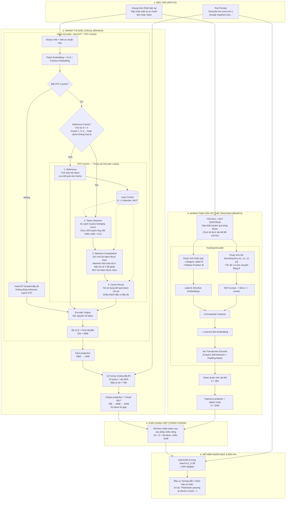


# NavSVLM System Architecture

Dưới đây là sơ đồ kiến trúc và luồng xử lý dữ liệu của **NavSVLM**. STC-Cacher được tích hợp tùy chọn trong Vision Encoder để giảm tính toán lặp giữa các frame. Các giá trị cập nhật 25% patch và chu kỳ tham chiếu 4 frame minh họa cấu hình benchmark; runtime mặc định tắt STC.

Sơ đồ thể hiện phụ thuộc dữ liệu; runtime thực thi các bước tuần tự. Tracker và mã hóa ảnh cập nhật ở mỗi frame, còn Q-Former, Tracking Encoder, Fusion và LLM chạy khi có yêu cầu sinh hướng dẫn. Tracking Encoder nhận thuộc tính vật thể hiện tại; thông tin thời gian đến từ trạng thái tracker. Thứ tự slot vật thể có thể thay đổi theo từng frame.

Ở selective frame, STC_Cacher so sánh key tại cùng vị trí patch với reference của cùng lớp. Reference không bị ghi đè bởi kết quả selective và được làm mới theo chu kỳ hoặc khi khởi tạo lại trạng thái. Hướng dẫn chi tiết về cơ chế, kích thước tensor và giới hạn thực nghiệm được trình bày trong [báo cáo kiến trúc](BAO_CAO_KIEN_TRUC_NOTION.md).
